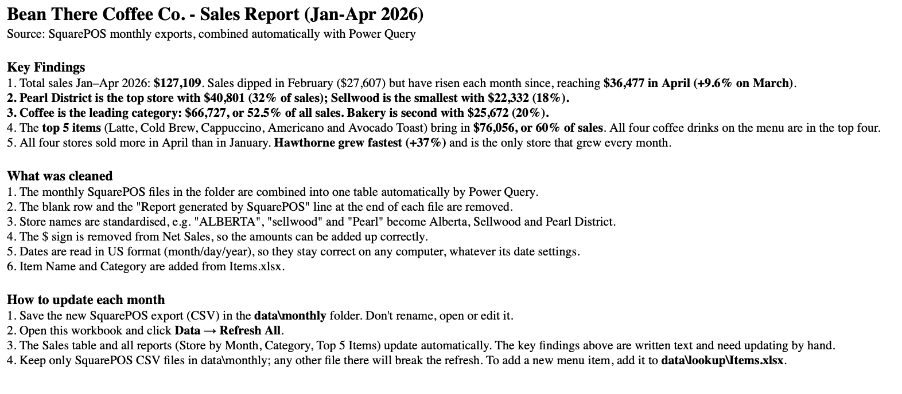
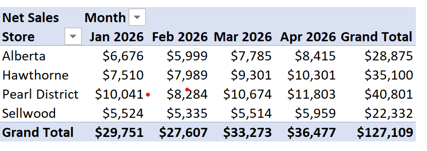

# Bean There Coffee Co. — Automated Monthly Sales Report (Excel Power Query)

> **Practice case study.** The client and data are fictional, created to practise a realistic freelance brief.



## The client's problem
Bean There Coffee Co. runs **4 coffee shops** in Portland, Oregon. Their point-of-sale system (SquarePOS) exports **one CSV file per month**, and the manager was combining them by copy-pasting every month.

The owner asked for one Excel file that:
1. Combines all monthly files **automatically** into one clean table
2. Shows sales **by store, by month**
3. Shows sales **by category** (Coffee, Tea, Bakery, Food, Retail)
4. Lists the **top 5 items** by sales
5. Updates with **no copy-pasting**: drop next month's file in the folder → Refresh All

## The solution
- **Power Query** reads every CSV in `data/monthly`, cleans it and loads one table (**Sales**, 3,174 rows for Jan–Apr 2026).
- Item names and categories are added from `data/lookup/Items.xlsx` with **Merge Queries**.
- **PivotTables** built on the Sales table: *Store by Month*, *Category* and *Top 5 Items*.
- A **Summary** sheet (first tab) gives the key findings, what was cleaned and how to update.
- A **ProjectFolder** parameter holds the folder path, so the file works on any PC.

**Tested:** April's file was added later as a "new month". After one **Refresh All**, rows grew from 2,380 to 3,174 and every report updated automatically.

## What was cleaned (automatically, on every refresh)
1. The monthly SquarePOS files are combined into one table by Power Query.
2. The blank row and the "Report generated by SquarePOS" line at the end of each file are removed.
3. Store names are standardised, e.g. "ALBERTA", "sellwood " and "Pearl" become Alberta, Sellwood and Pearl District.
4. The $ sign is removed from Net Sales, so the amounts can be added up correctly.
5. Dates are read in US format (month/day/year), so they stay correct on any computer, whatever its date settings.
6. Item Name and Category are added from Items.xlsx.

## Key findings (Jan–Apr 2026)
1. Total sales: **$127,109**. Sales dipped in February ($27,607) but have risen each month since, reaching **$36,477 in April (+9.6% on March)**.
2. **Pearl District** is the top store with $40,801 (32% of sales); **Sellwood** is the smallest with $22,332 (18%).
3. **Coffee** is the leading category: $66,727, or **52.5%** of all sales. Bakery is second with $25,672 (20%).
4. The **top 5 items** (Latte, Cold Brew, Cappuccino, Americano and Avocado Toast) bring in **$76,056, or 60% of sales**.
5. All four stores sold more in April than in January. **Hawthorne grew fastest (+37%)** and is the only store that grew every month.



## How to update each month
1. Save the new SquarePOS export (CSV) in the **data/monthly** folder. Don't rename, open or edit it.
2. Open the workbook and click **Data → Refresh All**.
3. The Sales table and all reports (Store by Month, Category, Top 5 Items) update automatically.
4. Keep only SquarePOS CSV files in data/monthly. To add a new menu item, edit **data/lookup/Items.xlsx**.

**First time on a new PC:** Data → Get Data → Launch Power Query Editor → click **ProjectFolder** → set it to the folder that contains this workbook (ending with `\`) → Close & Load.

## Skills shown
Excel Power Query (From Folder, Combine Files, filters, Trim/Capitalize, Replace Values, Change Type with locale, Merge Queries, parameters) · PivotTables · data cleaning · reconciliation (row counts and totals checked against the raw files) · client reporting

## Folder structure
```
BeanThere_Sales_Report.xlsx   ← the report (Summary first)
data/monthly/                 ← one SquarePOS CSV per month (raw, untouched)
data/lookup/Items.xlsx        ← item names, categories, menu prices
images/                       ← screenshots
```

**Tools:** Excel 2019 (Windows), Power Query, Git & GitHub
